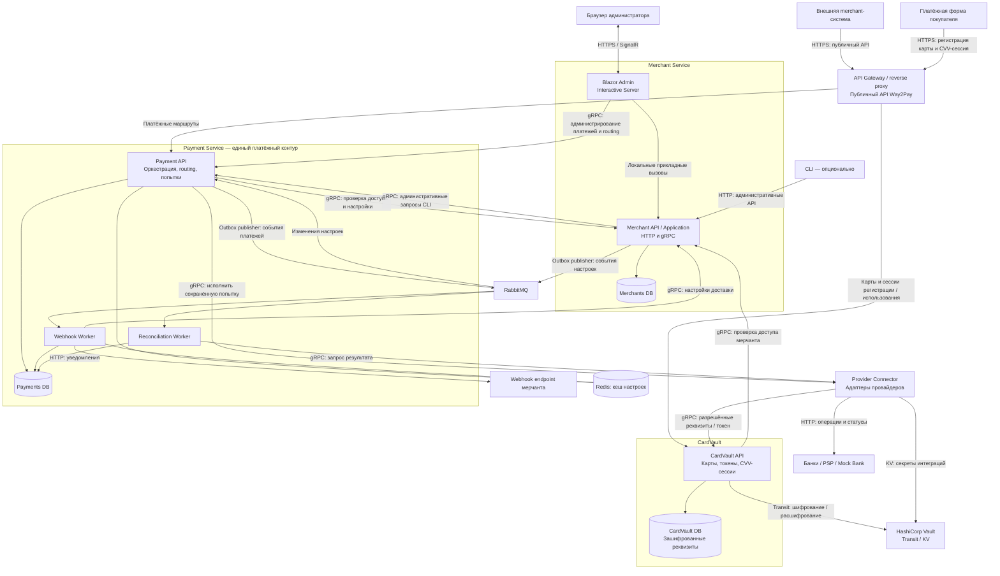

# Way2Pay — архитектура приложения

**Статус:** согласованная целевая архитектура; открытые вопросы отмечены отдельно.

**Обновлено:** 24 октября 2026 года.
**Функциональные требования:** [req.md](req.md).

Документ описывает приложение целиком: его состав, владельцев данных, взаимодействие компонентов, инфраструктуру и последовательность разработки. Базовые решения из обсуждения зафиксированы ниже; новые предложения явно отмечены. Детальные таблицы, состояния, API-контракты и настройки инфраструктуры проектируются на следующем уровне.

Подробные решения по карточным потокам: [CardVault и Provider Connector](decisions/0001-cardvault-and-provider-connector.md). Исходное ТЗ остаётся черновиком; уточнения о хранении карт, составе сервисов и владельцах данных зафиксированы в архитектурных документах. Описание целевой системы не означает, что все компоненты уже реализованы. Изменение согласованных границ обсуждается с пользователем и отражается в документации.

## 1. Назначение и границы системы

Way2Pay — платформа обработки электронных платежей. Она предоставляет внешним merchant-системам единый API, выбирает платёжного провайдера, выполняет операции, восстанавливает их результат при сбоях и уведомляет мерчантов.

Проект развивается от курсовой по теме «Проектирование базы данных системы обработки электронных платежей» к дипломной работе. Разработка ведётся в целевых границах сервисов с тремя самостоятельными бизнес-БД. Этапы отличаются полнотой реализованных функций; временное объединение сервисов или перенос владения данными между ними не планируются.

В границы Way2Pay входят:

- управление мерчантами, доступом и настройками интеграции;
- обработка и история платёжных операций;
- настройка и выполнение правил маршрутизации;
- интеграция с несколькими провайдерами;
- приём и долговременное защищённое хранение карт, внутренняя токенизация и использование токенов провайдеров;
- безопасное переключение провайдера и восстановление неопределённых операций;
- доставка уведомлений;
- веб-администрирование, аудит и наблюдаемость.

Внешний магазин мерчанта и банковский процессинг находятся за границами платформы. Mock Bank и демонстрационный клиент относятся к окружению разработки и защиты.

Chargebee служит ориентиром для настройки маршрутизации и обзора прохождения платежей, Authorize.net — для модели операций и взаимодействия со шлюзом. Подписки, тарифные планы, выставление счетов, собственные балансы и бухгалтерский ledger пока не входят в согласованный объём. Их добавление потребует отдельного архитектурного решения.

Текущий объём ограничен банковскими картами. Банковские счета и другие способы оплаты не реализуются; существующее значение `BankAccount` в коде не означает поддержку этого сценария. Сохранённые карты могут использоваться повторно; полноценное управление подписками остаётся будущей функциональностью.

## 2. Основные архитектурные решения

1. **Четыре основные службы:** Merchants, Payments, CardVault и Provider Connector. Каждая имеет явно определённую ответственность; отдельный процесс Connector изолирует вызовы, использующие открытые реквизиты, от Payments.
2. **Три бизнес-БД:** Merchants DB, Payments DB и CardVault DB. У каждой свой DbContext и свои миграции EF Core Code First. Для Connector отдельная бизнес-БД на этом этапе не требуется.
3. **Payments запускается несколькими процессами:** Payment API, Webhook Worker и Reconciliation Worker. Они используют общие прикладные правила и Payments DB. Платёжный жизненный цикл реализован как персистентная последовательность шагов с идемпотентным приёмом запросов; Reconciliation Worker восстанавливает неопределённые шаги, запрашивая провайдера через Connector.
4. **Веб-админка встроена в Merchant Service:** Blazor Web App с режимом Interactive Server. Она запускается и выпускается вместе с Merchant API. CLI — дополнительный клиент тех же административных возможностей.
5. **HTTP используется для внешних интеграций, gRPC — для внутренних синхронных вызовов, RabbitMQ — для асинхронных событий.**
6. **Redis используется как кеш.** Финансовая история и работа, которую необходимо восстановить после сбоя, сохраняются в SQL Server.
7. **Routing Engine входит в Payments, адаптеры провайдеров — в Provider Connector.** Источник конфигурации мерчанта, подключений и опубликованных политик — Merchants. Payments использует версионированный снимок конфигурации и сохраняет результат маршрутизации конкретной операции.
8. **CardVault хранит реквизиты и контролирует их использование.** PAN и CVV не проходят через Payments. HashiCorp Vault Transit обеспечивает криптографические операции; KV используется для секретов интеграций и приложений.
9. **Один репозиторий и одно основное solution.** Общий репозиторий не означает общую доменную модель или доступ сервисов к чужим таблицам.
10. **Единый публичный API Way2Pay скрывает внутренние сервисы.** API Gateway / reverse proxy направляет запросы владельцам сценариев. Платёжные операции обслуживает Payments, регистрацию и хранение карт — CardVault. Выбор реализации gateway пока не утверждён.

Получается шесть основных серверных приложений: Merchant API со встроенной админкой, Payment API, CardVault API, Provider Connector и два worker-приложения Payments. Самостоятельных владельцев бизнес-данных три. Браузер открывает админку Merchant Service; отдельного серверного приложения для неё нет. Возможный CLI, Mock Bank и инструменты инфраструктуры считаются отдельно.

API Gateway добавляется как инфраструктурный компонент перед публичными API. Он не является пятым бизнес-сервисом, не владеет бизнес-БД и не переносит к себе платёжную оркестрацию.

## 3. Общая схема



Стрелки обозначают основные взаимодействия, а не последовательность одного запроса. Reconciliation Worker также самостоятельно находит незавершённую работу в Payments DB. Redis и RabbitMQ не читают бизнес-таблицы самостоятельно — с ними работают приложения.

При токенизации провайдера форма обращается к hosted fields / SDK выбранного провайдера; CardVault получает защищённую ссылку на соответствующий токен. Если PAN / CVV проходят через gateway, он входит в границу обработки карточных реквизитов; тела таких запросов не логируются, не кешируются и не помещаются в очереди. Возможный отдельный адрес приёма реквизитов под доменом Way2Pay скрывается нашим SDK; конкретная топология требует отдельного согласования. Входящий HTTP endpoint событий провайдера и контракт доставки нормализованного события в Payments ещё требуют согласования; на схеме этот путь намеренно не закреплён.

Blazor Admin и Merchant API находятся в одном процессе. Админка вызывает управление мерчантами и публикацию политик локально через Merchant Application; историю платежей и платёжные действия — через административный gRPC-контракт Payments. Проверка routing на данных платежа выполняется движком Payments. Подход к размещению UI описан в разделе 8.

### 3.1. Публичный API и регистрация карты

Мерчант интегрируется с Way2Pay API и не выбирает адреса Payments или CardVault. Примеры публичных маршрутов: `/payments` направляется в Payments, `/card-registration-sessions` и `/cards` — в CardVault. Это иллюстрация распределения ответственности, а не окончательный версионированный HTTP-контракт.

Публичная документация является частью внешнего контракта и доступна во всех окружениях. Каждый сервис генерирует документ `public-v1`, включая только endpoints с явно заданной группой `public-v1`. Gateway публикует документы по `/openapi/payments.json` и `/openapi/cards.json`; один интерфейс Scalar по `/scalar` показывает их как разделы Payments и Cards без склейки спецификаций. Относительный server URL `/` направляет запросы из документации через тот же публичный адрес gateway. Описания DTO и операций остаются в сервисах; внутренние и административные API в публичный документ автоматически не включаются.

Сохранение карты является самостоятельным сценарием и не требует создания платежа или checkout в Payments. Backend мерчанта создаёт разрешение регистрации через публичный API; gateway направляет запрос в CardVault. Право мерчанта проверяется по данным Merchants. Наша форма использует краткоживущее разрешение и передаёт реквизиты по карточному маршруту; CardVault извлекает доверенные MerchantId и ссылку на покупателя из проверенного разрешения. Секретный API-ключ мерчанта остаётся на его backend и не передаётся в JavaScript.

Разрешение регистрации не является CVV-сессией или разрешением раскрыть реквизиты Connector. CheckoutId не обязателен для самостоятельного сохранения карты; возможная связь с checkout и общий сценарий оплаты проектируются отдельно. Формат разрешения, способ хранения, одноразовость, отзыв и поведение повторных запросов ещё требуют утверждения.

Gateway обеспечивает маршрутизацию и общие транспортные ограничения. Конкретный сервис проверяет право выполнить действие и принадлежность ресурса мерчанту. Внутренние gRPC API и endpoint раскрытия реквизитов не публикуются автоматически через gateway. Gateway не обращается к бизнес-БД и не выбирает провайдера. Конкретный продукт (например, YARP) и размещение TLS ещё не выбраны.

## 4. Ответственность приложений

| Приложение / компонент | Ответственность | Данные |
|---|---|---|
| **API Gateway / reverse proxy** | Единая публичная точка входа, явные маршруты к сервисам, общие транспортные ограничения | Не владеет бизнес-БД; проверки бизнес-доступа остаются в сервисах |
| **Merchant API** | Мерчанты, доступ, настройки подключений, публикация политик routing, пользователи, Blazor-админка | Владеет Merchants DB |
| **Payment API** | Внешний платёжный API, состояния, операции, попытки, routing, идемпотентность, применение результатов | Владеет Payments DB совместно со своими workers в рамках одного сервиса |
| **CardVault API** | Приём карт, внутренние токены, долговременное защищённое хранение, CVV-сессии, контроль раскрытия реквизитов, ссылки на токены провайдеров | Владеет CardVault DB; использует Vault Transit |
| **Provider Connector** | Адаптеры провайдеров, выполнение конкретной попытки, запрос статуса, нормализация результатов | Без отдельной бизнес-БД на текущем этапе; доступ к CardVault и нужным секретам Vault |
| **Webhook Worker** | Отправка событий внешним мерчантам; повторная доставка; журнал результатов | Использует Payments DB и настройки из Merchant Service |
| **Reconciliation Worker** | Поиск неопределённых и зависших операций; запрос результата через Connector; согласованное обновление состояния | Использует Payments DB |
| **Outbox publishers** | Публикация сохранённых событий своего сервиса в RabbitMQ | Читают Outbox только своего сервиса |
| **Blazor Admin — модуль Merchant Service** | Настройка системы, редактор правил, просмотр платежей, действия оператора | Merchant Application вызывается локально; Payment Service — по gRPC |
| **Admin CLI — опционально** | Автоматизируемые административные команды, импорт и экспорт настроек | Использует те же прикладные возможности через API |
| **Mock Bank** | Независимая имитация провайдера с управляемыми результатами и сбоями | Собственное тестовое состояние |
| **Demo Merchant — опционально** | Демонстрация создания платежа, checkout и приёма уведомлений | Собственные демонстрационные данные |

Outbox publishers являются фоновыми компонентами соответствующих API-приложений. Отдельное приложение Publisher в обязательную структуру не добавляется.

Payment API и его workers используют общие Domain/Application/Infrastructure-библиотеки. Это осознанная граница одного сервиса с несколькими процессами. Они согласованно обновляют схему и правила; независимое изменение схемы одним worker недопустимо.

## 5. Владение данными

### 5.1. Merchants DB

Здесь находятся исходные данные мерчанта и его доступа:

- мерчанты, статус подключения и административные сведения;
- API-ключи, их полномочия и отзыв;
- пользователи, роли и принадлежность пользователей к мерчантам;
- разрешённые мерчанту подключения провайдеров;
- исходная конфигурация аккаунтов провайдеров и их возможностей, ссылки на секреты Vault;
- черновики, опубликованные версии политик и деревья условий маршрутизации;
- webhook endpoints, подписки на события и данные для управления секретами подписи;
- версии настроек;
- аудит изменений в этом сервисе и его Outbox.

Merchant Service не хранит копию всей истории платежей для вывода её в админке: эти данные запрашиваются у Payment Service.

### 5.2. Payments DB

Здесь находятся платёжные данные и результаты обработки:

- платежи, операции, попытки обращения к провайдерам;
- история состояний и результаты внешних взаимодействий;
- ссылки на внутренние карточные токены или защищённые ссылки на токены провайдеров и необходимый исторический снимок;
- решения движка: кандидаты, выбранный провайдер и причины выбора;
- записи идемпотентности;
- работа по reconciliation и её история;
- события, задания на webhook-доставку и попытки доставки;
- технические записи надёжной обработки: Outbox, Inbox и незавершённая работа;
- аудит действий в платёжном контуре.

Merchants является источником конфигурации и опубликованных политик. Payments получает их версионированный снимок через контракт сервиса, допускает кеширование в памяти / Redis и выполняет правила. В Payments DB сохраняются версии и решения конкретной операции, а не вторая редактируемая копия всей конфигурации мерчанта. Connector выполняет выбранную интеграцию, используя конфигурацию её владельца и секреты из Vault; самостоятельную копию настроек не редактирует.

### 5.3. CardVault DB

CardVault владеет сохранёнными картами, внутренними токенами, принадлежностью мерчанту, метаданными и зашифрованными реквизитами, защищёнными привязками токенов к аккаунтам провайдеров и аудитом доступа. Точная схема и сроки хранения ещё проектируются.

Transit не хранит переданные карточные данные: шифротекст сохраняется в CardVault DB, ключами управляет HashiCorp Vault. CVV не входит в долговременную модель карты, SQL-таблицы, KV, журналы, события или очереди; для текущей оплаты используется отдельная краткоживущая сессия в памяти CardVault.

### 5.4. Связи между БД

Между базами передаются идентификаторы и контракты. Межбазовых внешних ключей, прямых SQL JOIN и чтения чужих таблиц нет. Проверка существования и доступности связанных объектов выполняется через API сервисов. Межсервисные изменения не считаются общей SQL-транзакцией: ошибки и незавершённые настройки должны быть видны оператору и допускать повторное завершение.

Payment Service хранит MerchantId, идентификаторы карточного источника, версии конфигурации и сохранённое решение маршрутизации. Менять настройки мерчанта через Payments DB нельзя. Владение картой и право её использования проверяет CardVault; знание токена не даёт права получить реквизиты. Мерчантов и подключения с финансовой историей деактивируют с сохранением ссылок.

Для локального окружения три логические базы могут находиться на одном SQL Server, сохраняя раздельные права и миграции. Redis и внутреннее хранилище HashiCorp Vault являются отдельными техническими хранилищами; они не входят в число трёх бизнес-БД.

## 6. Основные потоки работы

### 6.1. Приём и выполнение платежа

1. Карта регистрируется в CardVault либо готовится токен выбранного провайдера. Payments получает только идентификатор источника; CVV при необходимости передаётся отдельно в CardVault.
2. Внешняя merchant-система отправляет платёжный запрос в Payment API. Payments проверяет доступ и получает версионированную конфигурацию Merchants.
3. Routing Engine выбирает упорядоченный маршрут с учётом доступности, разрешений и совместимости карточного источника.
4. До внешнего денежного вызова Payments сохраняет операцию, решение маршрутизации, конкретную попытку и данные идемпотентности.
5. Connector получает запрос исполнения этой попытки, проверяет выбранную интеграцию и получает разрешённые реквизиты / токен из CardVault. Адаптер вызывает провайдера.
6. Connector возвращает нормализованный результат; Payments сохраняет финансовое состояние, историю и событие. Событие затем публикуется через Outbox.
7. Payments решает, завершить операцию, остановить её для действия покупателя, продолжить маршрут или перейти к reconciliation. Мерчант получает HTTP-ответ и дальнейшие обновления через GET / webhook.

Обрыв клиентского соединения не означает отмену уже принятой операции. После принятия работа должна восстанавливаться по данным БД. Для длительных сценариев API возвращает идентификатор и признак незавершённой обработки.

### 6.2. Неопределённый результат

Если нельзя доказать результат денежного вызова, операция переходит в неопределённое состояние. Reconciliation Worker запрашивает через Connector результат у того же провайдера; нормализованный результат или событие завершает обработку через общие прикладные правила Payments. Если провайдер не позволяет надёжно найти операцию, результат остаётся неопределённым и требует дальнейшего разбора.

До выяснения результата повторное списание через другого провайдера запрещено. Неустранимая неопределённость становится задачей для оператора. Сбой одной операции, например возврата, не должен стирать ранее подтверждённый финансовый результат платежа.

### 6.3. Уведомление мерчанта

Webhook Worker получает событие, определяет получателя по настройкам Merchant Service и создаёт устойчивую запись доставки в Payments DB. Затем отправляет отдельный HTTP-запрос на внешний endpoint мерчанта и сохраняет результат.

Адрес, версия конфигурации и содержание конкретной доставки сохраняются для объяснимых повторов. Отключение endpoint и отзыв секрета имеют приоритет над историческим снимком. Неуспешная доставка не меняет финансовый результат платежа.

### 6.4. Изменение настроек

Админка направляет изменение владельцу данных. Merchants изменяет параметры мерчанта, конфигурацию подключений и публикует версии политик; Payments получает снимок и выполняет опубликованные правила. Изменения аудируются. События об изменениях обновляют или инвалидируют кеши потребителей.

## 7. Routing Engine и интеграции

Routing Engine — модуль Application в Payments. Он вычисляет дерево типизированных условий на опубликованном снимке политики из Merchants, используя контекст платежа и предварительно определённые доступные аккаунты. Сам движок не обращается к сети или БД. Результат сохраняется как неизменяемый маршрут операции с упорядоченными шагами.

Архитектура предусматривает:

- редактируемые черновики и неизменяемые опубликованные версии политик;
- явный порядок применения правил и поведение при отсутствии подходящего провайдера;
- проверку правил на тестовых данных без денежного вызова;
- сохранение версии политики и объяснения решения;
- проверку обязательных ограничений до выбора: возможностей провайдера, доступа, валюты, платёжного метода;
- повторную проверку изменяемых ограничений перед фактическим вызовом.

Provider Adapter размещается в Connector и преобразует запрос конкретной сохранённой попытки и результаты в модель банка. Разные адаптеры поддерживают разные возможности. Authorize, charge, capture, void и refund имеют общие прикладные контракты, но доступность операции определяется состоянием платежа и возможностями выбранного аккаунта.

`IPaymentProviderGateway` остаётся интерфейсом Application Payments. Его инфраструктурная реализация вызывает Connector по внутреннему контракту. Connector не выбирает следующего провайдера, не создаёт попытки и не изменяет Payments DB. Один процесс Connector содержит несколько адаптеров; отдельный микросервис на каждого провайдера не требуется.

В текущей модели Capture, Void и Refund связаны с исходной транзакцией и выполняются через её аккаунт провайдера. Для них новая CVV-сессия не нужна. Токен одного аккаунта провайдера не считается пригодным для другого; provider-token flow ограничивает маршрут доступными совместимыми привязками. В собственной токенизации CardVault возможность другого адаптера работать с картой проверяется явно.

Исходящие денежные вызовы выполняются по специальной политике повторов. Общие настройки retry HTTP-клиента не должны автоматически повторять такие операции. Переключение провайдера и повторное обращение к тому же провайдеру — решения платёжной логики.

Подтверждённое отсутствие денежного эффекта — необходимое, но не достаточное условие перехода к следующему провайдеру. Учитывается категория отказа: допустимо продолжение, требуется действие покупателя либо дальнейшие попытки запрещены. При `Unknown` маршрут останавливается. Доступ к CVV ограничен текущей операцией и коротким сроком; подробные правила описаны в [архитектурной записи](decisions/0001-cardvault-and-provider-connector.md).

## 8. Веб-админка, CLI и доступ

Веб-админка включает следующие области:

| Область | Возможности |
|---|---|
| Мерчанты | Настройки, ключи, разрешённые подключения, webhook endpoints |
| Правила | Создание, проверка, публикация и просмотр версий политик |
| Платежи | Поиск, фильтрация, подробности и временная линия прохождения |
| Провайдеры | Конфигурация подключений, поддерживаемые операции и доступность |
| Восстановление | Неопределённые операции, результаты сверки, допустимые действия оператора |
| Доставка событий | Состояние webhook, попытки и управляемый повтор доставки |
| Аудит | Кто, когда и какие настройки или операции изменил |

Путь платежа показывает платёж → операции → routing decisions → попытки → результаты → сверку → уведомления. Он восстанавливается из бизнес-истории Payments DB. Техническая трассировка дополняет эту историю.

**Согласованное решение:** Blazor Web App с режимом Interactive Server размещается в том же ASP.NET Core приложении, что и Merchant API. Компоненты интерфейса выполняются на сервере и взаимодействуют с браузером через SignalR. Встроенная админка использует пользователей, роли и прикладные функции Merchant Service.

Управление мерчантами, ключами, webhook endpoints, подключениями и публикацией политик выполняется локальными вызовами Merchant Application. Просмотр платежей, проверка routing на контексте платежа и платёжные действия выполняются через внутренний административный gRPC API Payments. Blazor-компоненты не обращаются к чужим БД и не содержат платёжных бизнес-правил. Админка не раскрывает PAN или CVV.

Интерфейс оформляется как Razor Class Library `Way2Pay.Merchants.Admin`, подключённая к Merchant API. Это позволяет отделить страницы и компоненты внутри solution, сохраняя единый процесс запуска и развёртывания. Для платёжных экранов используются клиенты контрактов Payment Service. Пользовательские черновики и результаты существенных действий сохраняются устойчиво, а не только в состоянии открытого интерфейса.

**Обоснование совместного размещения:** управление мерчантами и админка используют общую модель пользователей, прав и настроек. Ожидается ограниченное число одновременно работающих административных пользователей; независимое масштабирование UI и Merchant API не является текущим требованием. Совместное размещение упрощает развёртывание и сопровождение системы для курсовой и диплома.

Авторизация ограничивает круг пользователей, но сама по себе не ограничивает нагрузку. История выдаётся постранично, диапазон и длительность поиска ограничиваются, дорогие действия имеют лимиты, длительные задачи выполняются в фоне. Payment Service контролирует нагрузку своих административных запросов на Payments DB.

Админка и Merchant API имеют общую границу доступности: перезапуск или перегрузка процесса затрагивает обе функции, включая проверку доступа для новых платёжных запросов. Этот компромисс принимается осознанно. Interactive Server также требует учитывать серверное состояние и соединения пользователей при масштабировании; подключение Redis само по себе не решает восстановление Blazor-сессий.

Пользовательская аутентификация — ASP.NET Core Identity в Merchant Service с защищённой cookie-сессией и защитой HTTP-запросов изменения данных от CSRF. Действия компонентов также проходят серверную авторизацию. Пользователи админки и API-ключи внешних мерчантов — разные виды доступа. CLI, если реализуется, получает собственный ограниченный способ авторизации к административным HTTP API, использующим те же прикладные функции.

С первого этапа проектируются роли и область доступа: администратор платформы, оператор, наблюдатель, пользователь конкретного мерчанта. Конкретный набор ролей уточняется при проектировании доступа. Сервисы проверяют полномочия на сервере; скрытие кнопки в UI не заменяет проверку.

Внутренние вызовы аутентифицируют вызывающий сервис и передают доверенный контекст пользователя для авторизации и аудита. Внешний клиент не может подставить такой контекст обычным заголовком. Payment Service проверяет право на запрашиваемое действие и принадлежность платежа мерчанту.

## 9. Инфраструктура и сторонние инструменты

| Технология | Назначение | Место в целевой системе |
|---|---|---|
| **.NET 10 / ASP.NET Core** | HTTP/gRPC API и фоновые приложения | Основной backend; соответствует направлению текущего проекта |
| **API Gateway / reverse proxy — продукт уточняется** | Единый публичный API и маршрутизация к владельцам сценариев | Перед публичными API; YARP рассматривается как кандидат |
| **EF Core Code First** | Модели хранения, конфигурации, миграции | Отдельно для каждой бизнес-БД |
| **SQL Server** | Устойчивое хранение бизнес-данных, транзакции, ограничения, запросы | Merchants DB, Payments DB и CardVault DB; локально SQL Server 2025 в контейнере |
| **HashiCorp Vault Transit** | Шифрование и расшифрование сохраняемых карточных реквизитов, управление ключами | Вызывается CardVault; шифротекст хранится в CardVault DB |
| **HashiCorp Vault KV** | Статические секреты приложений и интеграций | Отдельные права сервисов; начальная идентификация для доступа к Vault настраивается отдельно |
| **gRPC / Protobuf** | Внутренние синхронные контракты | Между владельцами данных и их потребителями |
| **RabbitMQ** | Доставка событий и сигналов фоновой обработки | Связывает сервисы и workers |
| **Redis** | Общий кеш разрешённых к кешированию настроек | Используется потребителями Merchant Service; не заменяет SQL |
| **ASP.NET Core Identity** | Учётные записи и аутентификация админки | Внутри Merchant Service |
| **Blazor Web App / Interactive Server / SignalR** | Встроенная серверная админка и взаимодействие с браузером | Размещается вместе с Merchant API; UI-модуль — Razor Class Library |
| **.NET Aspire AppHost** | Запуск локального окружения, зависимости, адреса сервисов и dashboard | Средство разработки и демонстрации |
| **Docker** | SQL Server, Vault, Redis, RabbitMQ и воспроизводимые образы приложений | Окружение разработки и развёртывания |
| **OpenTelemetry + Aspire Dashboard** | Логи, метрики, трассировка, диагностика | Базовая наблюдаемость |
| **OpenAPI** | Описание внешних и административных HTTP API | Интеграция и проверка контрактов |
| **xUnit + Testcontainers** | Проверка правил и интеграций с настоящими инфраструктурными зависимостями | Предлагаемый набор для тестирования |
| **Prometheus / Grafana / хранилище трассировок** | Долговременный мониторинг | Необязательное расширение для диплома |

Aspire не является частью платёжной логики и не заменяет план развёртывания. Для автономного запуска окружения предусматривается Docker Compose. Версии SDK, NuGet-пакетов и контейнеров фиксируются в репозитории при реализации.

В текущем локальном запуске Aspire запускает .NET API процессами, SQL Server 2025 и остальные инфраструктурные зависимости — контейнерами. SQL Server использует постоянный volume. Подключение к Payments передаётся по ключу `payments-db`; для самостоятельного запуска API и инструментов миграций используется конфигурация startup-проекта, включая User Secrets в Development.

Целевое основное окружение: контейнеры микросервисов на Raspberry Pi и внешние облачные БД, например Azure SQL Database. Вместо локального SQL-ресурса AppHost / окружение развёртывания предоставляет внешние строки подключения под теми же ключами. Настройки EF для Azure SQL и доступность сетевого подключения проверяются отдельно. Для Raspberry Pi подготавливаются ARM64-образы приложений; перенос локального SQL Server-контейнера на ARM64 не предполагается.

HashiCorp Vault вводится как целевой инструмент секретов и криптографии. Текущие User Secrets для локальной разработки остаются допустимыми до подключения Vault. Платёжная токенизация реализуется CardVault с Transit; зависимость от лицензируемого Vault Transform не принимается.

Kubernetes, service mesh, отдельная аналитическая БД, поисковый кластер и внешний workflow engine не входят в обязательную архитектуру. Для описанных функций пока нет потребности добавлять эти зависимости.

## 10. Роль Redis и RabbitMQ

### Redis

Источник настроек мерчанта — Merchants DB. Payment Service и Webhook Worker используют кеш и обращаются к Merchant Service по gRPC при отсутствии данных. Версия, срок жизни и события изменения ограничивают использование устаревших настроек.

Кеш допускает временное расхождение с источником. Решения об отзыве API-ключа, блокировке мерчанта и отключении webhook требуют отдельной политики актуальности; их нельзя объявить мгновенными только за счёт Redis. Базовый выбор — проверять критичные разрешения через Merchant Service, сохраняя кеш для обычной конфигурации. Недоступность проверки приостанавливает новое защищённое действие.

Очистка Redis не должна уничтожать платежи, защиту от повторов, историю или задания доставки. Устойчивые снимки конкретных решений хранятся в Payments DB.

### RabbitMQ

Каждый сервис сохраняет событие в своём Outbox вместе с изменением данных. Его publisher доставляет событие в RabbitMQ. Получатели учитывают повторную доставку и сохраняют результат обработки устойчиво.

Заранее различаются сообщения о событиях и команды на выполнение действий. Общий порядок сообщений между всеми потребителями не предполагается. Восстановление незавершённой работы опирается на БД, в том числе если уведомление из очереди задержалось.

Недоступность RabbitMQ задерживает фоновые уведомления; события остаются в Outbox. Очередь не становится источником финансового состояния. Необработанные сообщения и окончательно неудачные доставки должны быть доступны оператору.

Для обоих механизмов предусматриваются ограниченные повторы и диагностируемое состояние ошибки. Сроки и интервалы относятся к конфигурации реализации.

## 11. Надёжность и эксплуатационные границы

| Ситуация | Архитектурное поведение |
|---|---|
| Повторный запрос мерчанта | Та же операция распознаётся по сохранённой идемпотентности; конфликт содержимого отклоняется |
| Провайдер мог выполнить операцию, но ответ потерян | Фиксируется неопределённость; выполняется сверка без нового списания |
| API, webhook банка и worker одновременно обрабатывают платёж | Общие правила и контроль конкурентного обновления защищают согласованность |
| Приложение упало между вызовом банка и записью результата | Сохранённая попытка позволяет найти незавершённую работу и запросить результат |
| Merchant Service недоступен | Новые действия, требующие проверки доступа, не выполняются; уже принятые платежи могут восстанавливаться по сохранённому контексту |
| Redis недоступен | Чтение конфигурации обращается к её владельцу; нагрузка может вырасти |
| RabbitMQ недоступен | Outbox сохраняет события до восстановления доставки |
| Сайт мерчанта недоступен | Webhook повторяется по политике доставки; платёж сохраняет свой результат |
| Payments DB недоступна | Новые денежные вызовы не начинаются без возможности сохранить их контекст |
| CardVault или Vault недоступен | Новая попытка, требующая недоступных реквизитов или секретов, не отправляется; стадия сбоя явно отделяется от неопределённого денежного результата |
| CVV-сессия истекла или потеряна при перезапуске | Карта остаётся сохранённой; если провайдеру нужен CVV, покупатель вводит его повторно |
| Ответ Connector потерян после возможного вызова провайдера | Фиксируется `Unknown`; повтор денежного RPC и переключение провайдера запрещены до выяснения результата |

Workers могут запускаться в нескольких экземплярах. Захват работы и защита от повторных денежных действий обеспечиваются устойчивыми данными и правилами обработки. Истечение времени ожидания само по себе не доказывает, что внешняя операция не выполнялась.

В Payments агрегат имеет `long Version`: успешные изменяющие методы корня увеличивают её, EF Core проверяет исходную версию как concurrency token. Изменения корня и дочерних сущностей сохраняются атомарно. Это заменяет автоматический поиск затронутых корней через отдельный helper и искусственное изменение даты. Ограничения БД дополняют проверку версии.

Полная недоступность Merchant Service может задерживать webhook, если требуется актуальная проверка endpoint или секрет подписи. Это осознанная зависимость: снимок URL не отменяет правила доступа.

## 12. Защита данных, аудит и наблюдаемость

Платформа предусматривает изоляцию данных мерчантов, разграничение административных прав, аутентификацию внутренних вызовов и защищённые соединения. Секреты провайдеров, ключи и пароли не попадают в исходники, события, открытые ответы и журналы. Целевое хранилище секретов — HashiCorp Vault с отдельными правами сервисов; первоначальная идентификация сервиса, разблокировка и эксплуатация Vault требуют отдельной настройки.

Поддерживаются собственная токенизация CardVault и provider-token flow через hosted fields / SDK провайдера. Сохраняемый PAN шифруется через Vault Transit и находится только в CardVault DB; открытые реквизиты обрабатываются только CardVault и Connector. Payments получает ссылки на источник и необходимые несекретные метаданные. CVV живёт только в краткоживущей сессии одной текущей операции, не сохраняется для будущих платежей и удаляется по правилам архитектурной записи. Разделение процессов и использование Vault сами по себе не гарантируют соответствия PCI DSS или исключения остальных компонентов из области оценки.

Адреса исходящих webhook контролируются, чтобы функция доставки не давала произвольный доступ к внутренней сети приложения.

Входящие webhook провайдера проверяются и сопоставляются с существующей операцией. Исходящие события подписываются, чтобы мерчант мог проверить источник. Тестовые и реальные подключения, ключи и данные должны быть явно разделены.

Аудит бизнес-действий хранится у владельца данных. Correlation ID связывает HTTP/gRPC-вызовы, сообщения, операции и технические логи. Наблюдаемость охватывает задержки обработки, ошибки провайдеров, неопределённые операции, очередь восстановления и состояние доставки уведомлений.

Веб-админка является инструментом оператора платформы. Aspire Dashboard и RabbitMQ Management остаются техническими инструментами разработчика и эксплуатации.

## 13. Структура репозитория и зависимости

Целевые области репозитория — Merchants, Payments, CardVault и ProviderConnector. Внутри Payments оркестратор остаётся основным прикладным механизмом. Ниже показана целевая структура; отсутствующие проекты не требуется создавать заранее.

```text
Way2Pay/
├── Way2Pay.slnx
├── src/
│   ├── Merchants/
│   │   ├── Way2Pay.Merchants.Api/
│   │   ├── Way2Pay.Merchants.Admin/            # Razor Class Library; размещается в Api
│   │   ├── Way2Pay.Merchants.Domain/
│   │   ├── Way2Pay.Merchants.Application/
│   │   ├── Way2Pay.Merchants.Infrastructure/
│   │   │   └── Persistence/Migrations/
│   │   └── Way2Pay.Merchants.Contracts/
│   ├── Payments/
│   │   ├── Way2Pay.Payments.Api/
│   │   ├── Way2Pay.Payments.Domain/
│   │   ├── Way2Pay.Payments.Application/
│   │   ├── Way2Pay.Payments.Infrastructure/
│   │   │   ├── Persistence/Migrations/
│   │   │   └── ProviderConnector/             # клиент отдельного Connector
│   │   ├── Way2Pay.Payments.Contracts/
│   │   ├── Way2Pay.Payments.Webhooks.Worker/
│   │   └── Way2Pay.Payments.Reconciliation.Worker/
│   ├── CardVault/
│   │   ├── Way2Pay.CardVault.Api/
│   │   ├── Way2Pay.CardVault.Domain/
│   │   ├── Way2Pay.CardVault.Application/
│   │   ├── Way2Pay.CardVault.Infrastructure/
│   │   │   └── Persistence/Migrations/
│   │   └── Way2Pay.CardVault.Contracts/
│   ├── ProviderConnector/
│   │   └── ...                               # один процесс, несколько адаптеров; проекты ещё уточняются
│   ├── Shared/
│   │   ├── Way2Pay.Common/
│   │   └── Way2Pay.Routing.Contracts/
│   ├── Admin/
│   │   └── Way2Pay.Admin.Cli/                 # опционально
│   ├── Sandbox/
│   │   ├── Way2Pay.MockBank/
│   │   └── Way2Pay.DemoMerchant/              # опционально
│   ├── Way2Pay.AppHost/
│   └── Way2Pay.ServiceDefaults/
├── tests/
│   ├── Merchants/
│   ├── Payments/
│   ├── CardVault/
│   ├── ProviderConnector/
│   ├── Contracts/
│   └── EndToEnd/
├── deploy/
│   └── compose.yaml
└── docs/
    ├── req.md
    ├── ARCHITECTURE.md
    ├── database/
    └── decisions/
        └── 0001-cardvault-and-provider-connector.md
```

- **Domain:** предметные сущности, правила и ограничения, независимые от EF, HTTP и RabbitMQ.
- **Application:** сценарии использования и интерфейсы необходимых внешних возможностей.
- **Infrastructure:** EF Core, транспорт сообщений, кеш, клиенты сервисов; адаптеры банков и PSP размещаются в Connector, клиент Vault — в CardVault / потребителях нужных секретов.
- **Api / Worker:** точки запуска и подключение зависимостей; используют прикладные сценарии.
- **Contracts:** внешние DTO, protobuf и схемы событий своего сервиса; не EF-сущности.
- **Merchants.Admin:** страницы и компоненты Blazor; вызывает Merchant Application локально и Payment Service через gRPC-контракты. Размещается и выпускается вместе с Merchants.Api.
- **ServiceDefaults:** общие технические настройки наблюдаемости и подключения инфраструктуры.

Application зависит от Domain, Infrastructure реализует прикладные интерфейсы, исполняемые приложения собирают зависимости. Сервисы не ссылаются на чужие Domain/Infrastructure. Между сервисами используются самостоятельные транспортные контракты. Общие бизнес-сущности и универсальная библиотека всех репозиториев не вводятся; общие Result и контракты деревьев routing уже выделены отдельно.

Миграции каждой БД принадлежат одному проекту. В развёртывании их применяет отдельный шаг, а не каждый экземпляр API и worker одновременно. Специфичные для SQL Server объекты допустимо создавать SQL внутри миграций; схема при этом остаётся управляемой Code First.

Изменение схем управляется EF Core Code First; параллельного независимого источника истины в SQL-проекте нет. Новые службы и перенос существующих адаптеров реализуются отдельными небольшими задачами после согласования контрактов.

## 14. Mock Bank и внешние интеграции

Mock Bank запускается отдельно и воспроизводит успех, отказ, задержку, недоступность и потерю ответа после выполнения операции. Для проверки переключения нужны минимум два логических провайдера либо два экземпляра mock-окружения.

Для восстановления результата mock сохраняет собственную историю в независимом тестовом хранилище, например SQLite с Docker volume. Это хранилище принадлежит имитации внешнего банка и не входит в три бизнес-БД Way2Pay. Mock не читает Payments DB и не вызывает внутренние методы оркестратора.

Реальный sandbox-провайдер подключается через тот же контракт адаптера. Authorize.net является кандидатом, а не уже выбранной обязательной интеграцией. Доступность sandbox, поддерживаемые методы и требования подключения проверяются перед реализацией адаптера.

В req.md сейчас есть два блока ограничений, один из которых допускает live-операции. Архитектура сохраняет возможность отдельного live-окружения, но реальные платежи не являются условием защиты курсовой. Конкретное включение live-режима остаётся отдельным решением.

## 15. Курсовая и диплом

Ниже — предлагаемый объём этапов. Формальные требования кафедры к оформлению, SQL-объектам и демонстрации ещё нужно сверить с методическими указаниями.

| Часть | Для курсовой | Для диплома |
|---|---|---|
| Четыре основные службы и три БД | Целевые границы и отдельные Code First-модели без временного объединения | Развитие тех же сервисов |
| CardVault и Connector | Собственная токенизация, модель защищённого хранения и изолированного вызова провайдера входят в целевую архитектуру; точный демонстрационный объём уточняется | Завершение обоих карточных потоков, аудита доступа и обработки сбоев |
| Проектирование БД | ER-модели, нормализация, связи, ограничения, индексы, словарь данных, обоснование снимков и истории | Дополнение моделей и анализ нагрузки |
| Платёжная модель | Платёж, операции, попытки, routing, история, идемпотентность | Расширение поддерживаемых сценариев |
| Merchant Service | Мерчанты, ключи, права и конфигурация, необходимые для работы системы | Полный административный набор возможностей |
| Mock Bank | Рабочая демонстрация успеха и отказов | Расширенные сценарии и тестирование сбоев |
| Reconciliation и webhooks | Модель хранения и контракты входят в фундамент; полная автоматизация может не входить в объём защиты БД | Рабочие самостоятельные workers и восстановление после сбоев |
| RabbitMQ / Outbox / Inbox | Архитектура и модели надёжной обработки предусмотрены; полная интеграция необязательна для защиты БД | Полный асинхронный поток |
| Redis | Контракт кеширования предусмотрен; запуск Redis необязателен для защиты БД | Кеш с согласованной политикой актуальности |
| Встроенная Blazor-админка | Рабочие экраны в Merchant Service для демонстрации данных, настройки и истории | Полный редактор правил и инструменты оператора в том же UI-модуле |
| CLI | Необязателен | Необязателен; добавляется при практической пользе |
| Наблюдаемость | Базовые логи и диагностика | Трассировка, метрики и обзор состояния всей системы |
| Реальный провайдер | Необязателен | Желателен sandbox-адаптер; live отдельно |
| Эксплуатация | Воспроизводимый запуск и сохранность данных | Автоматизация развёртывания, восстановление резервных копий, нагрузочные испытания |

Необязательность компонента для защиты означает возможность не завершать его реализацию к этой дате. Она не означает временную смену владельца данных или замену целевой архитектуры демонстрационной схемой. Таблицы и миграции добавляются последовательно внутри заранее определённого владельца.

Проверки должны подтверждать ограничения БД, одновременную обработку запросов, отсутствие повторного денежного эффекта, восстановление неопределённого результата, повторную доставку сообщений и изоляцию мерчантов. Для диплома добавляются испытания остановки и перезапуска приложений и инфраструктуры.

## 16. Что проектировать следующим

1. Уточнить транспортные контракты Payments → Connector, Connector → CardVault и клиентского API CardVault по согласованной [архитектурной записи](decisions/0001-cardvault-and-provider-connector.md).
2. Детализировать первую оплату, CVV-сессию, разрешение на доступ к карте, допустимые отказы и переход к следующему провайдеру.
3. Пересмотреть существующий VO `PaymentMethod` и запрос провайдеру: текущая реализация ожидает заранее подготовленные привязки, а целевой контракт поддерживает два источника карты.
4. Спроектировать минимальные сущности, таблицы и жизненный цикл CardVault; решить, требуется ли отдельная сохраняемая сущность разрешения на доступ.
5. Реализовать CardVault, интеграцию Vault Transit и Connector небольшими задачами; затем завершать HTTP-сценарий Payments и интеграции с Merchants.

Точные состояния продолжения (`Pending`, действие покупателя / 3DS), нормализация отказов, получение статуса после `Unknown`, сроки хранения и API управления картами ещё уточняются. Их нельзя считать реализованными или утверждёнными только по наличию концептуального описания. Точная длительность CVV-сессии, протокол её завершения и работа нескольких экземпляров CardVault также требуют проектирования.

Подход к админке согласован: встроенный Blazor Interactive Server в Merchant Service, локальные вызовы Merchant Application и gRPC к Payment Service, общие пользователи и роли на ASP.NET Core Identity. Тестовое хранилище Mock Bank остаётся предложением для отдельного утверждения.

## 17. Источники для проверки технических решений

Внешние материалы использованы для проверки ограничений инструментов. Распределение ответственности и структура Way2Pay являются проектным решением этого документа.

- [EF Core: контроль конкурентных изменений](https://learn.microsoft.com/en-us/ef/core/saving/concurrency).
- [RabbitMQ: надёжность, подтверждения и повторная доставка](https://www.rabbitmq.com/docs/reliability).
- [Microsoft: cache-aside и ограничения согласованности кеша](https://learn.microsoft.com/en-us/azure/architecture/patterns/cache-aside).
- [.NET HTTP resilience: настройка повторов денежных HTTP-вызовов](https://learn.microsoft.com/en-us/dotnet/core/resilience/http-resilience).
- [Blazor Web App: режимы рендеринга](https://learn.microsoft.com/en-us/aspnet/core/blazor/components/render-modes?view=aspnetcore-10.0).
- [Blazor: аутентификация и авторизация](https://learn.microsoft.com/en-us/aspnet/core/blazor/security/?view=aspnetcore-10.0).
- [Blazor: управление серверным состоянием](https://learn.microsoft.com/en-us/aspnet/core/blazor/state-management/server?view=aspnetcore-10.0).
- [Chargebee: настройка, публикация и проверка правил маршрутизации](https://www.chargebee.com/docs/payments/2.0/payment-gateways-and-configuration/advanced-routing-rules).
- [Chargebee: Gateway Activity Logs](https://www.chargebee.com/docs/payments/2.0/payment-lifecycle-logs/gateway-activity-logs).
- [Authorize.net: типы и ограничения платёжных операций](https://developer.authorize.net/api/reference/features/payment-transactions.html).
- [Authorize.net: hosted payment form](https://developer.authorize.net/api/reference/features/accept-hosted.html).
- [Vault Transit: криптографические операции без хранения переданных данных](https://developer.hashicorp.com/vault/docs/secrets/transit).
- [Vault KV: статические секреты](https://developer.hashicorp.com/vault/docs/about-vault/why-use-vault/static-secrets).
- [PCI SSC: CVV и повторные платежи](https://www.pcisecuritystandards.org/faqs/1280/).
- [Spreedly: токенизация и краткоживущий CVV](https://developer.spreedly.com/docs/tokenization).
